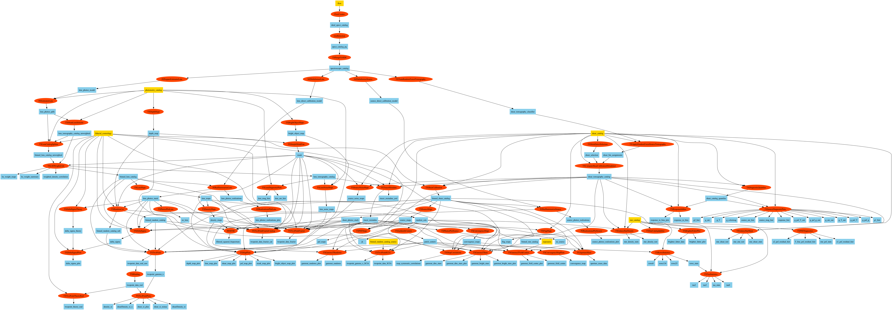

Running an example pipeline
===========================

Running
-------

Download data for a test pipeline like this:

.. code-block:: bash

    curl -O https://portal.nersc.gov/cfs/lsst/txpipe/data/example.tar.gz
    tar -zxvf example.tar.gz

This creates a ``data/example`` directory containing the input files in ``data/example/inputs``. Make sure you have activated the TXPipe environment (see :ref:`TXPipe Installation`), and run a test pipeline like this:

.. code-block:: bash

    ceci examples/metadetect/pipeline.yml

The Example Pipeline
--------------------

The example pipeline runs on 1 square degree of simulated sky, using a simulated catalog in the metadetect format. This is too small to check any numerical results, and is just designed to test that the code runs without crashing.

The main steps in it are:

#. Source selection (``TXMetaDetectSelection``), tomography (a random forest, trained by ``TXTrainRandomForestTomography`` and applied by ``TXApplyRandomForestSourceTomography``) and shear calibration (``TXComputeShearCalibrationMetadetect``). See :ref:`Source selection and tomography`.
#. Lens selection, and the calibrated tomographic catalogs of sources and lenses.
#. Maps of the shear, lens density, and survey properties, and mask and metadata generation.
#. Photo-z n(z) estimation for each tomographic bin.
#. Real-space two-point measurements, blinding, theory predictions, covariances, and plots of them.
#. Diagnostics of the shear catalog and PSF, including the shear response in bins of signal-to-noise and size.

Other example pipelines in the ``examples`` directory cover the other shear catalog types (``metacal``, ``scalar_metadetect``, ``lensfit``, ``hscy3`` and so on); these are listed in :ref:`Example pipelines`.

A flow chart showing the steps in the pipeline and the files it generates is shown below (you may have to open it in its own browser tab to see the details).

You can make charts like this using:

.. code-block:: bash

    python bin/flow_chart.py examples/metadetect/pipeline.yml metadetect.png

Results
-------

Once the pipeline is complete, the results will be stored in ``data/example/outputs_metadetect``. Some are PNG images you can look at directly. Others are HDF5 files - see :ref:`Reading HDF5 Files`.

Under the hood
----------------

When you do this, the following things are happening under the hood:

#. The ``ceci`` program reads the pipeline yml file and finds the ``PipelineStage`` classes listed in it.  It connects stages together to pass data from one to the next.

#. ``ceci`` runs the stages one by one, printing out the command line it uses. The outputs and logs of the tasks are put in locations defines in the pipeline yml.

#. When each stage is run, it is passed inputs, outputs, and the path to a configuration file, in this case ``examples/metadetect/config.yml``. This is searched for configuration information for the stage, which is stored in a dictionary attribute on the stage, ``stage.config``.

#. The ``run`` method on the stage is called to do the actual work of the stage. This method calls other methods to find the paths to its inputs and outputs, but otherwise can perform the calculation however it wishes.